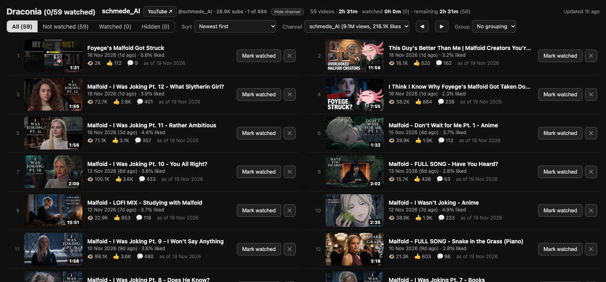
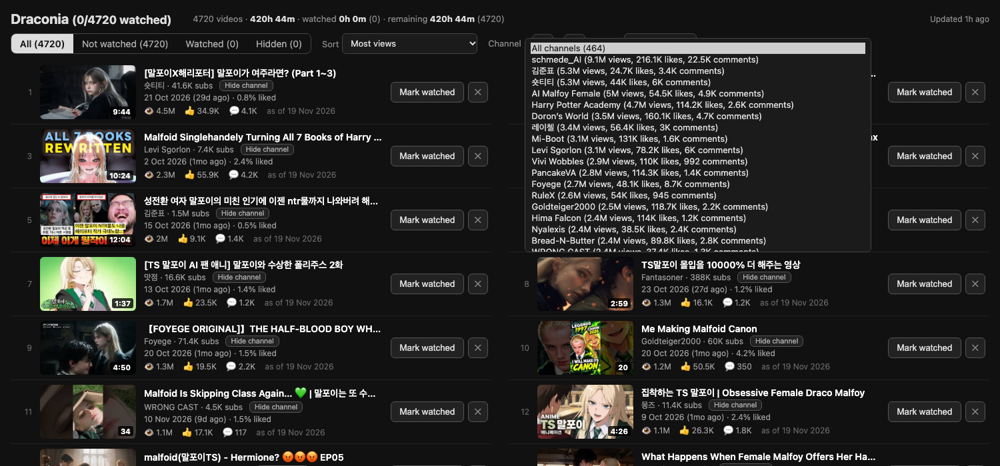
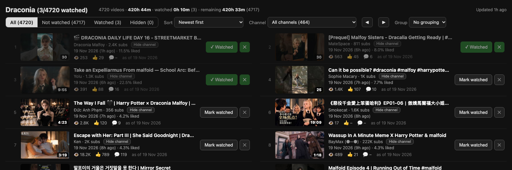
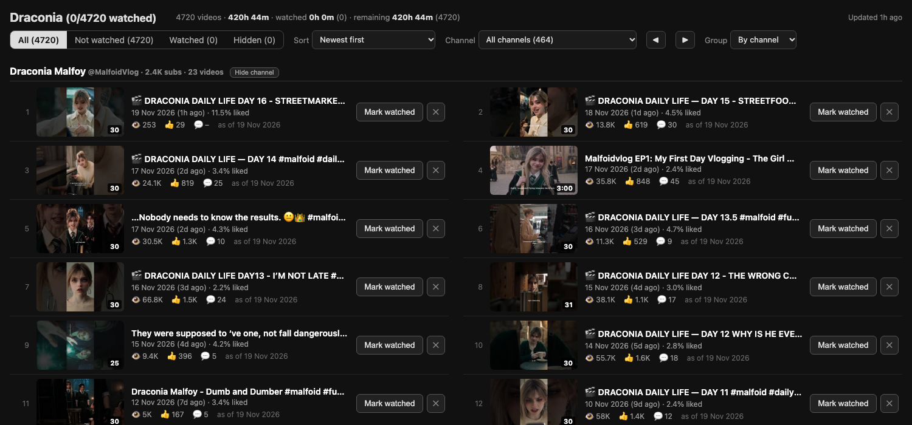
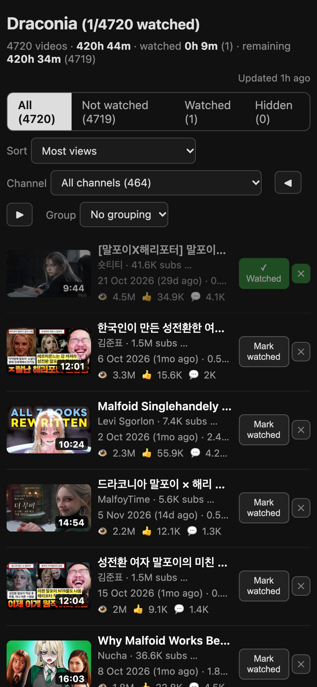

# Draconia

**Every Draconia Malfoy (Malfoid, female Draco Malfoy) video on YouTube, in one list.** About 4,700 AI-made fan films, music videos, comic dubs and shorts from 464 channels, with views, likes, comments and length. Mark what you watched, hide what you don't want, and see how many hours are left.

**Live:** https://p32929.github.io/draconia/


## Why I built this

The Malfoid trend blew up fast. New episodes come out every day from hundreds of small channels, in English, Korean, Chinese and more, and YouTube only shows you a few of them. I kept losing track of which episodes I had already seen and which channels I had not checked yet.

So I made one page with all of them. It shows every video with its numbers, lets me sort by what is most popular or newest, look at one channel at a time, and tick off what I watched. I hope it helps other fans find the good ones too.

## Screenshots

**One channel at a time.** Click a channel name to see only its videos. ◀ ▶ moves to the next channel:



**Pick a channel by its numbers.** Each channel shows the total views, likes and comments of its videos:



**Keep track of what you watched.** Watched videos turn green, and the top shows hours watched and hours left:



**Group by channel**, sorted however you like:



**On a phone:**

<p align="center">
  
</p>

## Features

1. **About 4,700 videos from 464 channels**, each with thumbnail, length, upload date, views, likes, comments and like rate.
2. **Sort** by most views, most likes, best like rate, most comments, newest, oldest, shortest, longest or biggest channel.
3. **Tabs:** All, Not watched, Watched and Hidden, each with a count.
4. **One channel at a time:** pick it from the list (with its total views, likes and comments) or click any channel name. ◀ ▶ go to the previous or next channel.
5. **Group by channel**, in the order of the sort you picked.
6. **Watch time:** total hours, hours watched and hours left for whatever you are looking at.
7. **Hide a channel** you don't want, or **✕** a single video that is not about Draconia. Both can be undone from the Hidden tab.
8. **Fast with thousands of videos:** only the rows on your screen are drawn.
9. **Shareable links:** the tab, sort, channel and grouping are saved in the address.
10. **Hover a number** to see how it changed on each day the stats were updated.

Your watched list, hidden channels and crossed-out videos are saved in your own browser. Nothing is sent anywhere.

## Run it yourself

The live site is a plain page and works without any setup. To also update the numbers, run the small server on your computer. It needs [Node.js](https://nodejs.org) and [yt-dlp](https://github.com/yt-dlp/yt-dlp). No npm packages.

```bash
git clone https://github.com/p32929/draconia.git
cd draconia
node server.js           # then open http://localhost:47821
PORT=8080 node server.js # or any port you like
```

With the server you get two more things:

1. **Refresh stats** fetches fresh views, likes and comments for every video with yt-dlp, and keeps one snapshot per day.
2. Your **watched list** is saved on your computer (`watched.json`) instead of in the browser.

To update the live site, press Refresh stats, then commit and push `data.json`.

## Where the videos come from

1. YouTube searches for Malfoid, Draconia Malfoy, female Malfoy and the Korean and Chinese names for her (말포이 TS, 여자 말포이, 女版馬爾福, 性轉馬份 and more).
2. Every video of each channel found that way, kept only if its title, tags or description is about her.
3. Numbers from each video's public YouTube page, read with yt-dlp.

Optional: put a `proxies.txt` next to `server.js` (one `host:port` per line). The server then spreads its requests over those proxies so YouTube does not block it and Refresh stats is much faster. Without it, it makes slow direct requests.

If a video is missing or does not belong here, please [open an issue](https://github.com/p32929/draconia/issues).

## Built with

1. **Plain HTML, CSS and JavaScript**: one `index.html`, no framework
2. **Node.js**: a small server with no dependencies
3. **yt-dlp**: reads the video details from YouTube
4. **GitHub Pages**: hosts the live site

## License

MIT License — Copyright (c) 2026 Fayaz Bin Salam. See [LICENSE](LICENSE) for the full text. The videos, thumbnails and channel names belong to their creators.

## Contributing

Contributions are very welcome, thank you! Before you start on a pull request, please open an issue and tell me what you would like to add or change. That way we can agree on it first, and your time is not wasted on something that might not fit. Thanks for helping make Draconia better.

## You might also like

<p><a href="https://openstore.pfay.workers.dev/more/p32929/draconia/personal/0"><picture><source media="(prefers-color-scheme: dark)" srcset="https://openstore.pfay.workers.dev/more/p32929/draconia/personal/0-dark.svg"></picture></a><a href="https://openstore.pfay.workers.dev/more/p32929/draconia/personal/1"><picture><source media="(prefers-color-scheme: dark)" srcset="https://openstore.pfay.workers.dev/more/p32929/draconia/personal/1-dark.svg"></picture></a><br><a href="https://openstore.pfay.workers.dev/more/p32929/draconia/personal/2"><picture><source media="(prefers-color-scheme: dark)" srcset="https://openstore.pfay.workers.dev/more/p32929/draconia/personal/2-dark.svg"></picture></a><a href="https://openstore.pfay.workers.dev/more/p32929/draconia/personal/3"><picture><source media="(prefers-color-scheme: dark)" srcset="https://openstore.pfay.workers.dev/more/p32929/draconia/personal/3-dark.svg"></picture></a></p>

<p><a href="https://p32929.github.io/share/?repo=draconia"><picture><source media="(prefers-color-scheme: dark)" srcset="https://p32929.github.io/readme/footer-share-dark.svg"></picture></a><a href="https://p32929.github.io/support/"><picture><source media="(prefers-color-scheme: dark)" srcset="https://p32929.github.io/readme/footer-support-dark.svg"></picture></a><br><a href="https://openstore.pfay.workers.dev/add"><picture><source media="(prefers-color-scheme: dark)" srcset="https://p32929.github.io/readme/footer-join-dark.svg"></picture></a></p>
